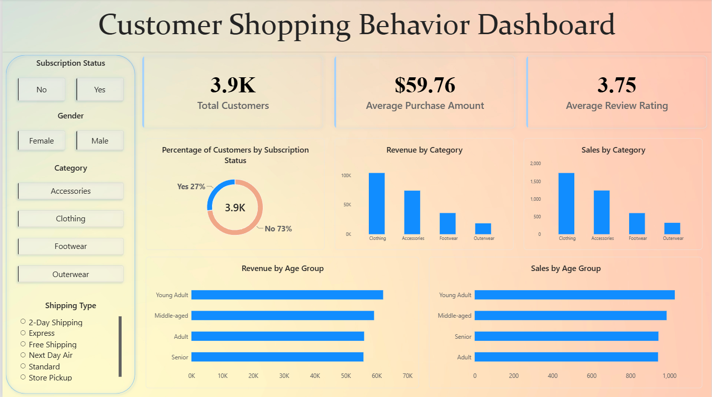

# Customer Shopping Behavior Analysis

An end-to-end data analytics project exploring customer purchasing patterns through **Python, SQL, and Power BI**.

The project follows a complete analytical workflow: starting with raw customer data, preparing it for analysis, answering business-focused questions with SQL, and presenting the most useful findings through an interactive Power BI dashboard.

This was built as a hands-on learning project, but the work went beyond simply following a tutorial. I reviewed the data, made and documented cleaning decisions, wrote and validated the SQL analysis, refined the dashboard interactions and presentation, and brought the full workflow together as a portfolio project.

## Business problem

A retail business wants to understand how its customers shop and which factors are connected to purchasing behaviour. The analysis focuses on customer demographics, product performance, subscription status, discounts, shipping preferences, review ratings, and purchase history.

The objective is to turn individual shopping records into answers that can support questions such as:

- Which customer groups contribute the most revenue?
- Which categories and products perform well?
- Do subscribers spend more than non-subscribers?
- How do discounts, shipping choices, and previous purchases relate to customer behaviour?
- Which insights are most useful for a clear management-level dashboard?

## Project workflow

| Stage | Tool | Work completed |
| --- | --- | --- |
| Data inspection and cleaning | Python, pandas, Jupyter Notebook | Examined the raw data, handled missing values, standardized columns, created analysis-ready features, removed a redundant field, and exported a clean dataset |
| Business analysis | MySQL | Validated the imported data and answered ten customer and sales questions using filtering, aggregation, subqueries, CTEs, conditional logic, and window functions |
| Dashboard development | Power BI | Built and refined a single-page interactive report with KPIs, category and age-group analysis, subscription distribution, and slicers |
| Portfolio preparation | Git and GitHub | Audited project files, removed repository clutter from version control, documented the workflow, and prepared the final project for publication |

## Dataset overview

The original dataset contains **3,900 customer shopping records** across **18 columns**. It includes:

- Customer age and gender
- Item purchased and product category
- Purchase amount and location
- Size, colour, and season
- Review rating
- Subscription and shipping status
- Discount and promotional-code usage
- Previous purchases
- Payment method and purchase frequency

After preparation, the cleaned dataset contains **19 analysis-ready columns**, no missing values, and no duplicate rows.

## Data preparation with Python

The notebook records the cleaning process step by step instead of hiding it behind a final CSV.

Key preparation decisions:

1. **Missing review ratings:** The raw data contained 37 missing ratings. These were filled using the median rating within the corresponding product category, which preserves category-level context better than applying one overall value.
2. **Consistent column names:** Column names were converted to lowercase, spaces were replaced with underscores, and `purchase_amount_(usd)` was simplified to `purchase_amount`.
3. **Customer age groups:** An `age_group` feature was created using dataset quartiles: Young Adult, Adult, Middle-aged, and Senior.
4. **Purchase-frequency conversion:** Text labels such as Weekly, Fortnightly, and Quarterly were mapped to approximate numbers of days in a new `purchase_frequency_days` column.
5. **Redundant data:** `promo_code_used` and `discount_applied` were checked row by row. Because their values were identical, the promotional-code column was removed.
6. **Final validation:** The cleaned data was checked for shape, remaining missing values, column structure, and duplicate rows before export.

The notebook uses relative file paths, so it can be run from the repository folder without machine-specific changes.

## SQL analysis

The SQL stage answers ten business questions:

1. What is the total revenue generated by male and female customers?
2. Which customers used a discount but still spent more than the average purchase amount?
3. Which five products have the highest average review rating?
4. How do average purchase amounts compare between Standard and Express shipping?
5. Do subscribed customers spend more than non-subscribers?
6. Which five products have the highest percentage of discounted purchases?
7. How can customers be segmented as New, Returning, or Loyal using previous purchases?
8. What are the three most-purchased products within each category?
9. Are repeat buyers more likely to subscribe?
10. What is the revenue contribution of each age group?

The analysis uses:

- Aggregate functions and grouped summaries
- Subqueries
- `CASE` expressions
- Common table expressions (CTEs)
- `ROW_NUMBER()` for category-level product ranking
- Conditional aggregation for a fair comparison of subscription rates

For the repeat-buyer question, subscription **rates** are compared instead of relying only on raw counts. A larger group naturally produces a larger count, and SQL should clarify the question rather than quietly make it more confusing.

## Power BI dashboard

The final report is a **single-page interactive dashboard** designed to provide a focused overview without overcrowding the canvas.

### Dashboard preview



*The final single-page dashboard combines customer KPIs, subscription distribution, category performance, age-group analysis, and interactive slicers.*

### KPI cards

- Total Customers
- Average Purchase Amount
- Average Review Rating

### Visual analysis

- Customer subscription distribution
- Revenue by category
- Sales by category
- Revenue by age group
- Sales by age group

### Interactive slicers

- Subscription Status
- Gender
- Category
- Shipping Type

The dashboard keeps the original gradient design direction while using consistent spacing, alignment, borders, chart formatting, and interactions. The ten SQL questions remain part of the wider analysis; they were not forced into ten separate visuals simply to make the dashboard look busier.

## Key findings

- The dataset represents **3,900 customers** and **$233,081 in total recorded revenue**.
- The average purchase amount is **$59.76**.
- The average review rating is **3.75 out of 5**.
- **Clothing** is the highest-performing category, with **1,737 purchases** and **$104,264 in revenue**.
- The **Young Adult** group contributes the highest age-group revenue at **$62,143**.
- Subscribers spend an average of **$59.49**, compared with **$59.87** for non-subscribers. For this dataset, subscription status is not associated with higher average spending.

These findings describe the supplied dataset. They are useful for analysis practice and business interpretation, but they should not be treated as universal retail behaviour.

## Repository structure

```text
customer-shopping-behavior-analysis/
|
|-- assets/
|   `-- customer-shopping-behavior-dashboard.png
|-- Customer Shopping Behavior Analysis.ipynb
|-- Customer Shopping Behavior Dashboard.pbix
|-- customer_shopping_behavior.csv
|-- clean_data.csv
|-- customer_shopping_behavior_analysis.sql
|-- README.md
|-- THIRD_PARTY_NOTICES.md
`-- .gitignore
```

| File | Description |
| --- | --- |
| `assets/customer-shopping-behavior-dashboard.png` | Preview of the final Power BI dashboard |
| `THIRD_PARTY_NOTICES.md` | Attribution and MIT licence notice for the reference project |
| `Customer Shopping Behavior Analysis.ipynb` | Python data inspection, cleaning, feature creation, and export workflow |
| `customer_shopping_behavior.csv` | Original customer shopping dataset |
| `clean_data.csv` | Cleaned dataset used for SQL analysis and Power BI |
| `customer_shopping_behavior_analysis.sql` | Data-validation queries and the ten-question SQL analysis |
| `Customer Shopping Behavior Dashboard.pbix` | Final accepted interactive Power BI dashboard |

## How to explore the project

### Python

1. Clone or download the repository.
2. Open `Customer Shopping Behavior Analysis.ipynb` in Jupyter Notebook.
3. Run the cells from top to bottom to reproduce `clean_data.csv`.

### SQL

1. Create or select the `customer_behavior` database in MySQL 8 or later.
2. Import `clean_data.csv` as a table named `clean_data`.
3. Run `customer_shopping_behavior_analysis.sql`.

### Power BI

Open `Customer Shopping Behavior Dashboard.pbix` in Power BI Desktop and use the slicers to explore different customer groups and purchasing patterns.

## Skills demonstrated

- Data inspection and cleaning with pandas
- Missing-value treatment and feature engineering
- Validation of data quality and redundant fields
- SQL analysis using CTEs, subqueries, window functions, and conditional aggregation
- Translating business questions into analytical queries
- Interactive dashboard development and visual refinement in Power BI
- Communicating findings without overstating what the data proves
- Organizing and documenting an end-to-end analytics project for GitHub

## Scope and limitations

- The data contains one record per customer and does not provide a separate order-level transaction history.
- It does not include an online/offline sales-channel field, so channel comparisons cannot be made honestly.
- Purchase-frequency day values are approximate mappings, not exact elapsed time between purchases.
- Age groups are based on dataset quartiles rather than fixed demographic standards.
- The dashboard is a focused overview. The SQL file contains the complete detailed analysis.

## Learning context and credit

This project was developed while learning an end-to-end analytics workflow from [Amlan Mohanty's Customer Shopping Trends project](https://github.com/amlanmohanty1/customer-trends-data-analysis-SQL-Python-PowerBI) and its accompanying tutorial.

The reference provided the original project direction. I completed the Python preparation, worked through and reviewed the SQL analysis, built and refined the Power BI dashboard, validated the project files, and documented the final workflow based on my own implementation and learning.

---

This project helped me move from practising tools separately to understanding how Python, SQL, and Power BI work together in one complete analysis.
